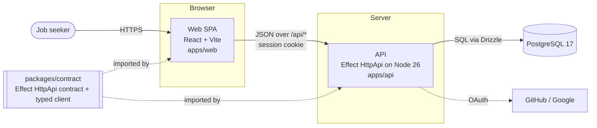
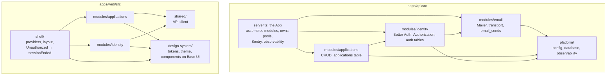
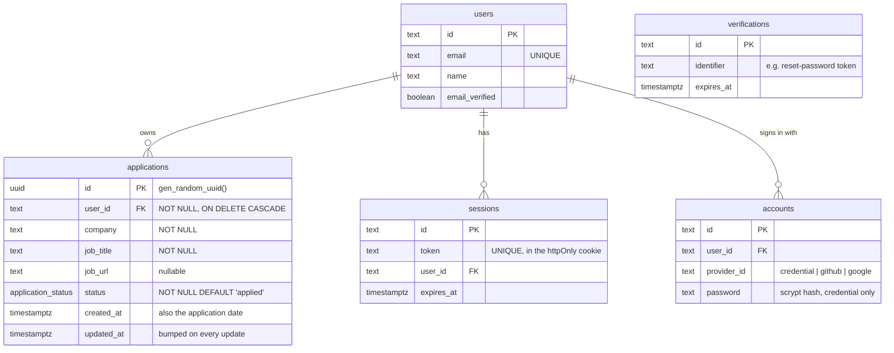
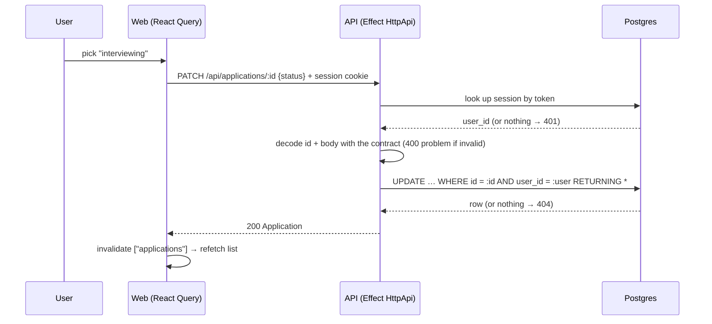
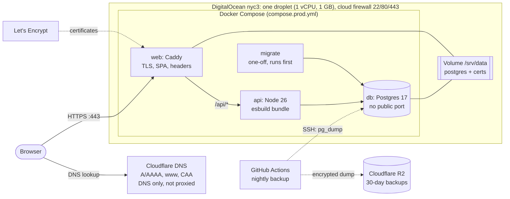
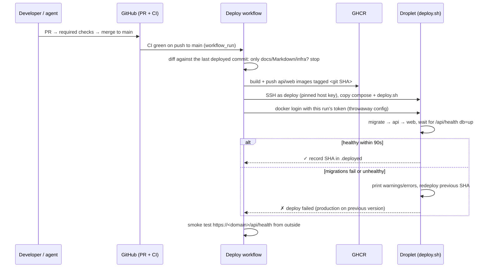

# Architecture

> **Living document.** This describes the system as it is _right now_. Update it in the same PR
> as any change to the components, data model, API, or infrastructure. The reasoning behind each
> choice lives in [ADRs](adr/README.md). Each dependency's alternatives are in
> [dependencies.md](dependencies.md).

_Last updated: 2026-11-20_

## 1. What the system does

Roundtable tracks software-engineering job applications: the company, the role, a link to the
job description, where the application stands, and when it was created and last changed. Each
user signs in (email and password, GitHub, or Google) and only ever sees their own applications.

## 2. Requirements and scale assumptions

| Dimension      | Now                                                                  | Planned                      |
| -------------- | -------------------------------------------------------------------- | ---------------------------- |
| Users          | multi-user with auth ([ADR-0011](adr/0011-authentication.md))        | ~12, possibly ~1,000s        |
| Rows per user  | hundreds                                                             | low thousands                |
| Read/write mix | read-heavy (list view), occasional writes                            | same                         |
| Availability   | single VPS, ~99.5–99.9% ([ADR-0012](adr/0012-hosting-single-vps.md)) | same until users demand more |

**Back-of-envelope estimate at the high end.** 5,000 users × 2,000 applications = 10M rows ×
~300 bytes ≈ 3 GB including indexes. Peak traffic is perhaps 5,000 users × 50 requests/day ≈
250k requests/day ≈ 3 req/s on average, maybe 30 req/s at peak. **One small Postgres instance and
one API process handle that easily.** At this scale the design challenges are correctness,
tenant isolation, and operability, not throughput. Section 8 lists what would change if that
stopped being true.

## 3. System context and containers



| Container           | Responsibility                                                                                                                                | Tech                                                                                                                   |
| ------------------- | --------------------------------------------------------------------------------------------------------------------------------------------- | ---------------------------------------------------------------------------------------------------------------------- |
| `apps/web`          | UI. Server state is cached and refetched with TanStack Query, through the typed client.                                                       | React 19, Vite 8, Effect 4 (client only)                                                                               |
| `apps/api`          | HTTP API, auth (sessions, OAuth), validation, persistence                                                                                     | Effect 4 HttpApi, Better Auth, Drizzle ORM (Effect driver on `@effect/sql-pg`, Promise driver on `pg` for Better Auth) |
| `packages/contract` | API contract as an Effect `HttpApi` definition, one file per module, and the typed client generated from it that the web app calls (ADR-0022) | Effect 4                                                                                                               |
| PostgreSQL          | System of record                                                                                                                              | Postgres 17 (Docker locally)                                                                                           |

In local dev, Vite proxies `/api/*` to the API, so the browser sees one origin and there is no
CORS setup. Production will keep the same-origin approach (section 7).

### Modules

Both apps are modular monoliths ([ADR-0023](adr/0023-modular-monolith-layout.md)): one deploy
each, with the code organized by module so a module can later become its own service or
microfrontend. Dependencies run one way, and `pnpm check:boundaries` fails on any import that
breaks the rules (another module's internals, the assembly, or another module's tables).



| Module       | API                                                                                                    | Web                                                            | Contract          |
| ------------ | ------------------------------------------------------------------------------------------------------ | -------------------------------------------------------------- | ----------------- |
| applications | CRUD handlers, `applications` table                                                                    | `ApplicationsPage` (form + table), its query keys              | `applications.ts` |
| identity     | One `IdentityLive` layer: Better Auth, the `Authorization` middleware, `/api/auth-config`, auth tables | `AuthGate`, `sessionEnded()`, sign-in and password-reset pages | `identity.ts`     |
| email        | One `EmailLive` layer: `Mailer` (sending limits), `EmailTransport` (Resend or the log), `email_sends`  | none                                                           | none              |
| (system)     | `/api/health`, in `server.ts`                                                                          | none                                                           | `system.ts`       |

**Design system** ([ADR-0024](adr/0024-design-system.md)): `apps/web/src/design-system/` holds
the web app's components (Button, TextField, Select, Alert, Dialog, Snackbar so far) and its theme. Base UI gives
each component its behavior (keyboard, focus, ARIA, menu positioning) and CSS Modules its
Material 3 look. Every style reads `--ds-*` tokens (color roles, type scale, shape, spacing),
each color defined once with `light-dark()`, so the `ThemeProvider` switches themes by setting
`data-theme` on `<html>`. Modules import only its `index.ts`, and only it imports Base UI.
The shell's `Providers` mounts the `SnackbarProvider` once (on Base UI's toast), so a module
reports a failed change without moving the page: a mutation opts in with
`meta: { errorSnackbar: true }` (applications does this for status changes), and `useSnackbar()`
stays for anything else. A snackbar is announced as an alert, stacks, and goes after 6 seconds or on
Dismiss. Errors tied to a form or dialog stay inline as an `Alert`.

**Identity** gives the App one layer, `IdentityLive`: its endpoint (`/api/auth-config`), the
`Authorization` middleware every protected group relies on, and Better Auth's `/api/auth/*`
routes, with Better Auth built inside. One rule decides which sign-in providers are configured,
for both the sign-in page and Better Auth. Better Auth answers its own failures, so identity
reports the unexpected ones (`BetterAuthFailed`) through `ErrorReporter`, like every other
module. The password minimum is part of the identity contract, so the web forms check the same
length the API enforces.

On the web, identity owns the whole session lifecycle, expiry included
([ADR-0032](adr/0032-web-identity-owns-session-expiry.md)). The shell's `QueryClient` sends every
query or mutation that fails with `Unauthorized` to identity's `sessionEnded()` (and doesn't retry
it); `AuthGate` then clears the query cache, re-checks the session and shows the sign-in page with
"You were signed out. Sign in again.". No feature module handles a 401. The shell also decides
which mutation errors reach the snackbar: those of mutations that opt in, except `Unauthorized`.
The shell reaches the snackbar from outside React through `createSnackbars()` (Base UI's toast
manager). Signing out shows the sign-in page only once the server confirms it; a failed sign-out
stays signed in with an error.

**Email** gives the App one layer too, `EmailLive(env, log)`: the `Mailer` identity sends
through. Inside, it reads its sending limits (the per-address and per-day caps,
`EMAIL_LIMIT_PER_ADDRESS` and `EMAIL_LIMIT_PER_DAY`) and picks its transport (Resend when
configured, otherwise the log), so a new limit or email kind never touches `server.ts`. The
email kinds (password reset, verification) are one `EmailKind` schema; limits are counted per
kind, per address. The App provides the `Database` it shares, and tests swap the transport
through `AppOptions.emailTransport`.

**The App** (`server.ts`) is the one module that knows every other. Callers pass `{ env, log }`
and pick one of two adapters: `serveApp` (a Node server, for production) or `appWebHandler`
(in-process, for tests). Inside, it creates both database pools from `DATABASE_URL` (Effect's for
the modules, the Promise one Better Auth needs) so they can't point at different databases,
starts Sentry, wraps everything in logging and error reporting, and on stop closes the pools and
flushes Sentry. `test/app-lifecycle.test.ts` checks that no connection outlives it.

Each module's `index.ts` is its public interface, and its tests sit next to it. A future split
moves a module folder and its tables out, and gives the remaining modules a second adapter at
the seam: for identity, the `Authorization` middleware would ask the identity service instead
of Better Auth in-process. The applications table's foreign key to `users` is the one place a
module reaches into another's tables, and would go with that split.

## 4. Data model



- **Tenant isolation:** every `applications` query filters on `user_id` from the session. Another
  user's ids return 404, never 403, so the API doesn't confirm they exist. Tested in
  `apps/api/src/modules/identity/identity.test.ts`.
- `users`, `sessions`, `accounts` and `verifications` are shaped by Better Auth
  ([ADR-0011](adr/0011-authentication.md)). One user can have several `accounts` (a password plus
  GitHub, say), which is how account linking works.
- `application_status` is a Postgres enum: `applied → screening → interviewing → offer →
accepted`, plus the terminal states `rejected` and `withdrawn`. Transitions aren't enforced
  ([ADR-0006](adr/0006-status-enum-and-dates.md)).
- Index `applications_user_id_updated_at_idx (user_id, updated_at DESC)` serves the only list
  query: one user's applications, newest first.
- Source of truth: each module's `schema.ts` (`apps/api/src/modules/*/schema.ts`): identity owns
  the auth tables, applications its own, email `email_sends`. One database and one migrations
  folder. Migrations are generated into `apps/api/drizzle/`,
  one folder each (`<timestamp>_<name>/migration.sql` + `snapshot.json`, Drizzle 1.0's layout)
  ([ADR-0004](adr/0004-drizzle-orm-and-migrations.md), [ADR-0022](adr/0022-effect-for-the-api.md)).

## 5. API

All routes are JSON under `/api`. The server is the Effect `HttpApi` definition in
`@roundtable/contract` ([ADR-0022](adr/0022-effect-for-the-api.md)): requests are decoded by its
schemas before any handler runs, a failed decode is a 400 RFC 9457 problem
(`application/problem+json`) naming each invalid value and why, and responses are encoded
through their schemas, so columns not in them (`userId`) never leave the server. Better Auth's
routes are mounted beside it. The web app calls the API through the client generated from the
same definition (`@roundtable/contract/client`): request bodies are encoded and checked before
they're sent, so invalid input fails in the browser with the server's own message; responses
are decoded (dates become `Date`s), so a contract mismatch fails at the boundary instead of deep
in the UI; and the contract's errors become messages for the user (`ApplicationNotFound`), or,
for `Unauthorized`, a return to the sign-in page (see Identity above). `client.test.ts` runs that client against the real server. The client costs about
40 KB gzipped of the web bundle (115 → 155 KB). Job URLs must be `http(s)`: the web app renders them as links, so `javascript:` or `data:` URLs
are rejected at the API rather than left to React and the CSP.

| Method   | Path                    | Auth    | Success | Errors                                                                |
| -------- | ----------------------- | ------- | ------- | --------------------------------------------------------------------- |
| GET      | `/api/health`           | public  | 200     | (reports `db: "down"` instead of failing)                             |
| GET      | `/api/auth-config`      | public  | 200     | (lists enabled social providers)                                      |
| GET/POST | `/api/auth/*`           | public  | varies  | Better Auth: sign-up/in/out, OAuth callbacks, password reset, session |
| GET      | `/api/applications`     | session | 200     | 401                                                                   |
| GET      | `/api/applications/:id` | session | 200     | 400 (malformed id), 401, 404 (unknown or not yours)                   |
| POST     | `/api/applications`     | session | 201     | 400, 401                                                              |
| PATCH    | `/api/applications/:id` | session | 200     | 400 (body or id), 401, 404                                            |
| DELETE   | `/api/applications/:id` | session | 204     | 400 (malformed id), 401, 404                                          |

The list isn't paginated. That's fine for hundreds of rows per user, and cursor pagination on
`(updated_at, id)` is the planned next step.

## 6. Request flows

### Changing a status



### Signing in with GitHub (OAuth 2.0 authorization code flow)

```mermaid
sequenceDiagram
  participant B as Browser
  participant A as API (Better Auth)
  participant G as GitHub
  B->>A: POST /api/auth/sign-in/social {provider: github}
  A-->>B: redirect URL (with state + PKCE challenge)
  B->>G: user approves the app
  G-->>B: redirect to /api/auth/callback/github?code=…&state=…
  B->>A: GET callback
  A->>G: exchange code (+ PKCE verifier) for tokens, fetch profile
  A->>A: find or create user; link to an existing account only if both sides verified the email
  A-->>B: Set-Cookie session (httpOnly, SameSite=Lax), redirect to /
```

### Security properties

- **Sessions** are opaque random tokens stored in Postgres. They go in an `httpOnly`,
  `SameSite=Lax` cookie, which page JavaScript can't read, so a cross-site scripting bug can't
  steal it. Sign-out deletes the row, which revokes the session immediately (unlike a JWT).
- **CSRF:** any state-changing request that carries a cookie must have an `Origin` matching
  `BETTER_AUTH_URL`, and is otherwise rejected with 403. Better Auth turns this check off when
  `NODE_ENV=test`, so the config forces it on and a test proves it.
- **Passwords:** at least 10 characters, hashed with scrypt by Better Auth. Reset tokens are
  single-use and expire.
- **Brute force:** Better Auth's rate limiter (in-memory, production only) throttles auth
  endpoints. With more than one API instance it would need shared storage
  ([ADR-0011](adr/0011-authentication.md)).
- **Email verification:** email/password sign-ups get no session until they click a link sent to
  their address, so every account's email is proven (account linking depends on it). Emails go
  through Resend from `mail.<domain>`, signed with DKIM under a DMARC `quarantine` policy. In
  development they're written to the API log instead ([ADR-0017](adr/0017-email-resend.md)).
- **Password reset** signs out every other session.
- **Account linking:** a GitHub or Google sign-in joins an existing account with the same email
  only when the provider has verified that email **and** the existing account confirmed it.
  Tests cover both refusals (an unconfirmed local account, an unverified provider email), which
  are how an attacker would otherwise get into someone else's account.
- **Email abuse:** at most 5 reset or verification requests and 10 sign-ups per IP per hour
  (Better Auth, in memory), then at most 3 emails of each kind per address and 80 in total per
  24 hours (Postgres, survives deploys). Over a limit the email is silently dropped
  ([ADR-0018](adr/0018-email-sending-limits.md)).

## 7. Environments and delivery

### Production deployment



- **Edge:** Caddy terminates TLS with automatic Let's Encrypt certificates, redirects HTTP and
  `www` to `https://<domain>`, serves the SPA (hashed assets cached for a year, `index.html`
  never cached), and sets HSTS, CSP, frame-deny and related headers.
- **Startup order:** `db` healthy → `migrate` exits 0 → `api` healthy → `web` starts. A failed
  migration means the new API never starts.
- **DNS:** records point straight at the reserved IP (Cloudflare's proxy is off). The CAA record
  allows Let's Encrypt; Cloudflare automatically adds its own CAs to that set.
- **Backups:** nightly, a GitHub Actions job streams `pg_dump` over SSH, encrypts it with age,
  uploads it to R2 (30-day retention, 7-day write-once lock), then restores that copy into a
  throwaway Postgres to prove it works. RPO 24 h, RTO about 15 min
  ([ADR-0015](adr/0015-backups.md)).
- **Email:** Resend's HTTP API, from `no-reply@mail.<domain>`. The API refuses to start in
  production without its key ([ADR-0017](adr/0017-email-resend.md)). A send that fails with a
  5xx, the per-second rate limit or a network error is retried twice more within about two
  seconds, under one idempotency key so Resend never delivers it twice; a 4xx or a used-up quota
  fails at once. Either way, the failure is logged and reported to Sentry with the email kind
  (`modules/email/`).
- **Monitoring:** Better Stack checks `/api/health` (must report the database up) every 3
  minutes from outside, and opens an incident only if it's still failing 60 seconds later, so a
  deploy's ~10-second gap doesn't page anyone, and expects a ping from every nightly backup. Sentry receives unexpected
  API errors, failed email sends and the daily-email-limit alarm, with cookies, bodies, query
  strings and database query parameters (a failed session lookup's would be the session token)
  stripped, and no console breadcrumbs
  ([ADR-0019](adr/0019-monitoring-and-error-tracking.md)).
- **Logs:** JSON lines from pino on stdout, kept by Docker. Better Auth logs through the same
  logger, and so does Effect (request logs, failures) through a bridge in `platform/observability/logging.ts`, which
  must wrap the whole server: provided anywhere narrower, Effect's request logs go to the
  console unredacted. The App (`server.ts`) applies it in both of its adapters, so no caller
  places it. `test/server.test.ts` runs the real server to check it. Errors are logged as type, message and stack only, and every line is
  scrubbed of database query parameters and of the token in a password reset link's path
  before it's written (`platform/observability/`). A failed deploy prints only the API's
  warning and error lines (and any non-JSON crash output) to the public Deploy workflow log;
  request logs stay on the server.
- **Disposable server:** IPs and the data volume are separate OpenTofu resources, so the server
  can be replaced at any time ([infra/README.md](../infra/README.md)).
- **Infrastructure state:** OpenTofu state is in R2, encrypted on the operator's machine before
  upload and locked during runs ([ADR-0016](adr/0016-remote-encrypted-state.md)).

### Delivery pipeline



Each deploy recreates the API and Caddy containers, so the site is down for about 10 seconds
(Caddy waits for the new API to be healthy). That's why merges that only touch docs, Markdown,
agent config or `infra/` (applied by a human with OpenTofu) don't deploy: the workflow compares
the commit with the last successful deploy run and skips the build and deploy when nothing that
ships changed. A failed deploy exits non-zero, so it never counts as the base, and the next merge
deploys again. Zero-downtime deploys are on the roadmap.

Rollback restores code only; migrations must stay backward-compatible with the previous release
([ADR-0014](adr/0014-push-based-deploys.md)). A rollback runs the previous release's migrator
first, and the API only starts if it succeeds. One caveat from the Drizzle 1.0 upgrade: 1.0 records
a migration's timestamp to the second, 0.45 to the millisecond, so **a migration applied by 1.0
looks unapplied to 0.45**, which then fails re-running it. Rolling back to a 0.45 release is safe
only while every migration in that release was applied by 0.45 itself. Production qualified:
checked on 2026-11-11 (three rows) before 1.0 was deployed with #33. Local databases that lagged behind may not be: recreate them if a
pre-upgrade branch fails to migrate.

| Environment | Status            | Notes                                                                                                                                                                                                                                                                                                                                                                                                                                                                                                                                                                                                                                                                                                                                                                                                                                                                                                                                                                                                                                                                                                                                                                                                                                                                                                 |
| ----------- | ----------------- | ----------------------------------------------------------------------------------------------------------------------------------------------------------------------------------------------------------------------------------------------------------------------------------------------------------------------------------------------------------------------------------------------------------------------------------------------------------------------------------------------------------------------------------------------------------------------------------------------------------------------------------------------------------------------------------------------------------------------------------------------------------------------------------------------------------------------------------------------------------------------------------------------------------------------------------------------------------------------------------------------------------------------------------------------------------------------------------------------------------------------------------------------------------------------------------------------------------------------------------------------------------------------------------------------------- |
| Local       | ✅ running        | `docker compose` Postgres (databases `app` and `app_test`), `pnpm dev`. The production stack also runs locally: `docker compose -f compose.prod.yml` with `DOMAIN=localhost`.                                                                                                                                                                                                                                                                                                                                                                                                                                                                                                                                                                                                                                                                                                                                                                                                                                                                                                                                                                                                                                                                                                                         |
| CI          | ✅ GitHub Actions | `check` (required): lint (Oxlint, including the anti-slop rules, [ADR-0021](adr/0021-oxlint-with-anti-slop-rules.md)), format, typecheck, Effect diagnostics (`@effect/tsgo`, [ADR-0022](adr/0022-effect-for-the-api.md)), dependency register, migration drift, tests. `mutation`: Stryker on the web app, advisory, survivors in the job summary and an artifact the reviewer reads ([ADR-0027](adr/0027-mutation-testing-stryker.md)). `api-mutation`: the same for the API on pull requests that touch it, reusing the nightly results to mutate only what changed (a full run when a change is one they can't see); `API mutation testing` is that nightly full run on main, a test database per Stryker worker. `images`: both production images build. `infra`: `tofu fmt` + `validate`. Also CodeQL, dependency review and Dependabot ([ADR-0010](adr/0010-public-repo-and-supply-chain-scanning.md)); CodeQL fails a PR on findings in the files it changed, and `Security alerts` opens a `security-triage` issue for each open alert on main ([ADR-0030](adr/0030-factory-code-scanning-findings.md)). Branches needn't be up to date to merge; `Main health` keeps a `main-broken` issue open while CI or Deploy fails on main ([ADR-0035](adr/0035-merge-without-updating-branches.md)). |

Every Monday, the Architecture review workflow runs Matt Pocock's `improve-codebase-architecture`
skill (vendored in `.github/factory/skills/`) unattended over recently changed code, uploads its
HTML report, and opens an `architecture` issue for each Strong candidate; the owner labels it
`ready` or closes it with a reason ([ADR-0031](adr/0031-weekly-architecture-review.md)). `Factory`: the implementer agent, on `ready` tickets ([ADR-0025](adr/0025-software-factory-implementer.md)). `Factory sweeper`: every 30 minutes, reruns a cancelled CI on a factory pull request once and labels any other stuck one `needs-human` with the reason ([ADR-0040](adr/0040-factory-sweeper.md)). `Security audit`: weekly, an agent runs throwaway fault-injection tests and files each finding as a private draft security advisory ([ADR-0036](adr/0036-weekly-security-audit.md)). `Review`: the reviewer agent, after green CI on every PR but Dependabot's own bumps ([ADR-0026](adr/0026-software-factory-reviewer.md), [ADR-0033](adr/0033-review-every-pull-request.md)). `Rework`: the implementer again, when the reviewer asks for changes on a factory PR ([ADR-0037](adr/0037-software-factory-rework.md)) |
| Production | ✅ live at https://roundtableapp.us | DigitalOcean + Cloudflare via OpenTofu ([ADR-0012](adr/0012-hosting-single-vps.md), [ADR-0013](adr/0013-digitalocean-instead-of-hetzner.md)); every green CI run on `main` deploys with health-checked rollback ([ADR-0014](adr/0014-push-based-deploys.md)) |

### Software factory

Tickets are GitHub issues written from the feature or bug form. When the owner labels one
`ready` (or mentions `@claude` on an issue or pull request), the Factory workflow runs Claude Code
in a GitHub Actions runner with Postgres, under `.github/factory/implementer.md` and `CLAUDE.md`.
It builds the ticket on a branch until `pnpm check` passes and opens a pull request as the Claude
GitHub App, so the usual CI runs on it; a human reviews and merges. Its token lives in the
`factory` environment, which only `main` can use, and a deterministic step after each run
rejects branches that change `.github/`, `.claude/` or `CLAUDE.md`
([ADR-0025](adr/0025-software-factory-implementer.md)).

Once CI passes on a new commit of any pull request from this repository except Dependabot's
(unless someone else, such as the CI fixer, has pushed to it)
([ADR-0033](adr/0033-review-every-pull-request.md)), or when the owner labels one `review`, the
Review workflow runs a second agent under `.github/factory/reviewer.md`. It reads the change
(checked out apart from `main`, never run) against its ticket, or its description when it has
none, and the repo's rules, and a deterministic step posts its verdict as one comment, updated in place. It never
approves; the owner merges, and can ask the implementer to address the review
([ADR-0026](adr/0026-software-factory-reviewer.md)). On the factory's own pull requests that
follow-up runs `pnpm check` and the tests before pushing; on anyone else's, the action refuses to
run the pull request's code ([ADR-0034](adr/0034-implementer-runs-checks-on-its-own-prs.md)).

When CI, dependency review or CodeQL fails on a factory pull request (or one labeled `autofix`,
which Dependabot's npm pull requests get automatically),
the Factory workflow restarts the implementer on that branch to fix it: it re-runs jobs that
failed for reasons outside the change, fixes the cause otherwise, and stops after two attempts
with a `needs-human` label ([ADR-0028](adr/0028-software-factory-ci-fixer.md)).

When the reviewer's verdict on a factory pull request is "changes needed", the Rework workflow
restarts the implementer on that branch with only the factory's own review comments: it fixes
what the review named, or disputes a finding with its reasons, and pushes, so CI and the
reviewer run again. It too stops after two attempts with `needs-human`, and shares the CI
fixer's per-branch concurrency group ([ADR-0037](adr/0037-software-factory-rework.md)).

Every agent job scrubs Anthropic credentials and the runner's OIDC tokens from the commands the
agent runs and isolates them (bubblewrap), allows only named `pnpm` and `git` commands, and checks
everything the factory publishes for credential patterns
([ADR-0029](adr/0029-software-factory-credential-hardening.md)).

```mermaid
flowchart LR
  T[Issue from a form] -->|owner labels ready| F[Factory workflow<br/>Claude Code + Postgres]
  F -->|questions| N[needs-info label]
  F -->|branch + PR as Claude App| CI[CI: required checks]
  CI -->|green| RV[Reviewer agent<br/>read-only, one comment]
  CI -->|red, up to 2 times| X[Fixer: the implementer<br/>on the same branch]
  X --> CI
  RV -->|changes, up to 2 times| RW[Rework: the implementer<br/>fixes the review's findings]
  RW --> CI
  RV -->|ready| H[Human review and merge]
  H -.->|@claude address the review| F
  H --> D[Delivery pipeline]
```

## 8. Known limits and what changes at scale

| Trigger                         | Change                                                                                                            |
| ------------------------------- | ----------------------------------------------------------------------------------------------------------------- |
| Need for history and analytics  | Append-only `application_events` table, so `updated_at` stops being the only trace                                |
| Lists in the thousands per user | Cursor pagination, plus server-side filter and sort                                                               |
| One server's CPU or RAM         | Bigger `server_type` (vertical scaling, minutes of downtime), then Postgres on its own server                     |
| Read load beyond one Postgres   | Connection pooling (PgBouncer), then a read replica. Caching only if measurements show it's needed                |
| Multiple API instances          | Already stateless (sessions live in Postgres), so add a load balancer. Move the rate limiter to Postgres or Redis |
