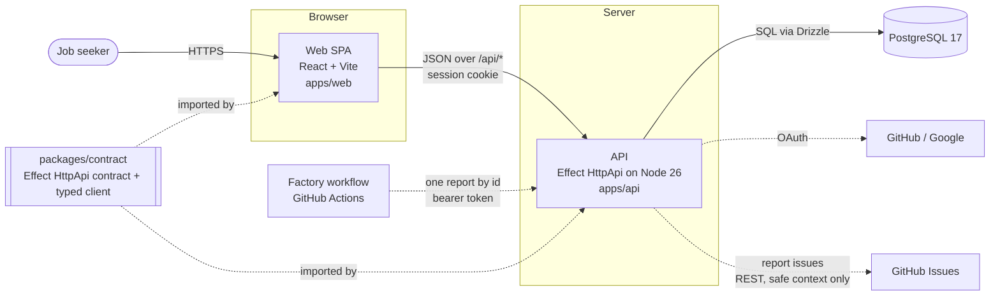
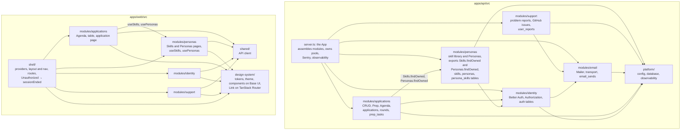
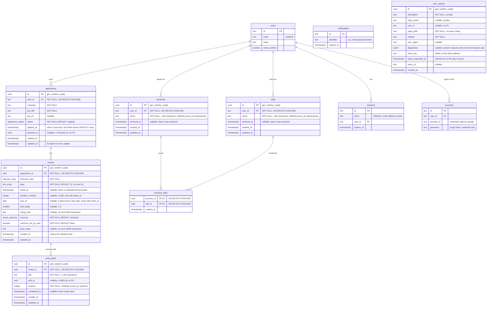
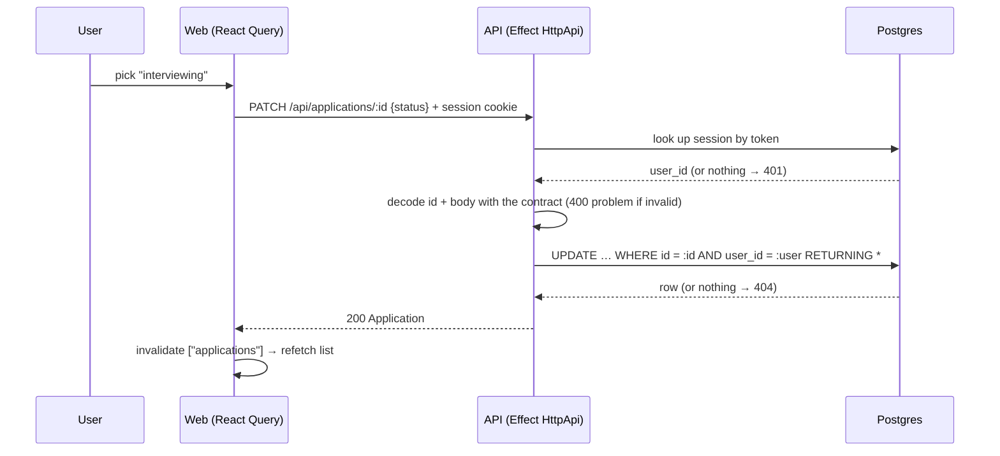
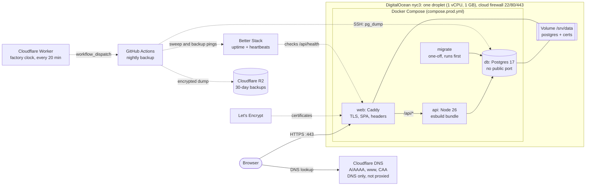
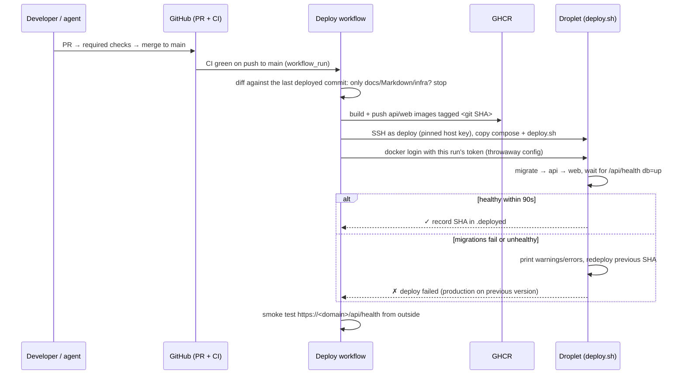

# Architecture

> **Living document.** This describes the system as it is _right now_. Update it in the same PR
> as any change to the components, data model, API, or infrastructure. The reasoning behind each
> choice lives in [ADRs](adr/README.md). Each dependency's alternatives are in
> [dependencies.md](dependencies.md).

_Last updated: 2026-11-26_

## 1. What the system does

Roundtable tracks software-engineering job applications: the company, the role, a link to the
job description, where the application stands, and when it was created and last changed. Each
user signs in (email and password, GitHub, or Google) and only ever sees their own applications.

## 2. Requirements and scale assumptions

| Dimension      | Now                                                                  | Planned                      |
| -------------- | -------------------------------------------------------------------- | ---------------------------- |
| Users          | multi-user with auth ([ADR-0011](adr/0011-authentication.md))        | ~12, possibly ~1,000s        |
| Rows per user  | hundreds                                                             | low thousands                |
| Read/write mix | read-heavy (list view), occasional writes                            | same                         |
| Availability   | single VPS, ~99.5–99.9% ([ADR-0012](adr/0012-hosting-single-vps.md)) | same until users demand more |

**Back-of-envelope estimate at the high end.** 5,000 users × 2,000 applications = 10M rows ×
~300 bytes ≈ 3 GB including indexes. Peak traffic is perhaps 5,000 users × 50 requests/day ≈
250k requests/day ≈ 3 req/s on average, maybe 30 req/s at peak. **One small Postgres instance and
one API process handle that easily.** At this scale the design challenges are correctness,
tenant isolation, and operability, not throughput. Section 8 lists what would change if that
stopped being true.

## 3. System context and containers



| Container           | Responsibility                                                                                                                                | Tech                                                                                                                   |
| ------------------- | --------------------------------------------------------------------------------------------------------------------------------------------- | ---------------------------------------------------------------------------------------------------------------------- |
| `apps/web`          | UI. Server state is cached and refetched with TanStack Query, through the typed client.                                                       | React 19, Vite 8, Effect 4 (client only)                                                                               |
| `apps/api`          | HTTP API, auth (sessions, OAuth), validation, persistence                                                                                     | Effect 4 HttpApi, Better Auth, Drizzle ORM (Effect driver on `@effect/sql-pg`, Promise driver on `pg` for Better Auth) |
| `packages/contract` | API contract as an Effect `HttpApi` definition, one file per module, and the typed client generated from it that the web app calls (ADR-0022) | Effect 4                                                                                                               |
| PostgreSQL          | System of record                                                                                                                              | Postgres 17 (Docker locally)                                                                                           |

In local dev, Vite proxies `/api/*` to the API, so the browser sees one origin and there is no
CORS setup. Production will keep the same-origin approach (section 7).

### Modules

Both apps are modular monoliths ([ADR-0023](adr/0023-modular-monolith-layout.md)): one deploy
each, with the code organized by module so a module can later become its own service or
microfrontend. Dependencies run one way, and `pnpm check:boundaries` fails on any import that
breaks the rules (another module's internals, the assembly, or another module's tables).



| Module       | API                                                                                                                                                                                                                | Web                                                                                                                                                                                                                                                                                                                     | Contract          |
| ------------ | ------------------------------------------------------------------------------------------------------------------------------------------------------------------------------------------------------------------ | ----------------------------------------------------------------------------------------------------------------------------------------------------------------------------------------------------------------------------------------------------------------------------------------------------------------------- | ----------------- |
| applications | CRUD handlers for applications and their Rounds with their Prep, the Agenda, `applications`, `rounds` and `prep_tasks` tables                                                                                      | `AgendaPage`, `ApplicationsPage` (form + table), `ApplicationPage` (with its `Rounds` and each Round's `RoundPrep`, which names Skills from personas' `useSkills()` and lists the Persona's first in its Skill picker), a Persona picker in the form and on the page (names from personas' `usePersonas()`), query keys | `applications.ts` |
| personas     | One `PersonasLive` layer: `/api/skills` (the skill library) and `/api/personas`, the `Skills` and `Personas` services other modules check ids with (`findOwned`), `skills`, `personas` and `persona_skills` tables | `SkillsPage` (add, rename, archive, restore), `PersonasPage` (list + add), `PersonaPage` (rename, archive, restore, tick Skills), `useSkills()` and `usePersonas()` (for other modules)                                                                                                                                 | `personas.ts`     |
| identity     | One `IdentityLive` layer: Better Auth, the `Authorization` and `OptionalSession` middleware, `/api/auth-config`, auth tables                                                                                       | `AuthGate`, `sessionEnded()`, sign-in and password-reset pages                                                                                                                                                                                                                                                          | `identity.ts`     |
| email        | One `EmailLive` layer: `Mailer` (sending limits), `EmailTransport` (Resend or the log), `email_sends`                                                                                                              | none                                                                                                                                                                                                                                                                                                                    | none              |
| support      | One `SupportLive` layer: `POST /api/reports`, `GET /api/factory/reports/:id`, `GitHubIssues` (GitHub's REST API or skipped), `user_reports`                                                                        | `ReportProblem` (link-style button + dialog)                                                                                                                                                                                                                                                                            | `support.ts`      |
| (system)     | `/api/health`, in `server.ts`                                                                                                                                                                                      | none                                                                                                                                                                                                                                                                                                                    | `system.ts`       |

**Routes** ([ADR-0049](adr/0049-tanstack-router.md)): the shell owns the web app's pages, in
`shell/router.tsx` (TanStack Router, code-based routes), and maps each to a module's root
component, passing the URL's params as props:

| Path                           | Page                                                                                                                                                                                    |
| ------------------------------ | --------------------------------------------------------------------------------------------------------------------------------------------------------------------------------------- |
| `/`                            | applications' `AgendaPage`: upcoming Rounds grouped by day, with time left and Prep progress, each linking to its application                                                           |
| `/applications`                | applications' `ApplicationsPage`: the form and the table, each company linking to its page                                                                                              |
| `/applications/$applicationId` | applications' `ApplicationPage`: company, job title, job link, status, applied date, Persona, Rounds with their Outcomes, Self-ratings, Tags and Prep (notes and a prep task checklist) |
| `/personas`                    | personas' `PersonasPage`: the active Personas with their Skill counts, each linking to its page, archived ones in a collapsed section, and the add form                                 |
| `/personas/$personaId`         | personas' `PersonaPage`: the Persona's name, Rename, Archive or Restore, and a checkbox for each active Skill (and each archived one it has); "Persona not found" otherwise             |
| `/skills`                      | personas' `SkillsPage`: the skill library, to add, rename, archive and restore Skills, archived ones in a collapsed section                                                             |
| `/reset-password`              | identity's password-reset page, shown by `AuthGate` before the router                                                                                                                   |
| anything else                  | the shell's "Page not found", with a link back to the Agenda                                                                                                                            |

Every signed-in page sits below the shell's header, which the router renders (so its links know
the current page): the title, the user's name, the theme and sign-out, and a "Pages" navigation
with "Agenda", "Applications", "Personas" and "Skills", the one for the page you're on marked `aria-current="page"`.
The Personas pages read Personas through personas' `usePersonas()`, under
`['personas', 'list']`: every Persona, archived ones included, each with its `skillIds`. A
Persona's page finds its Persona there (there's no `GET /api/personas/:id`) and names its Skills
from `useSkills()`, in the library's order; other modules read Personas through the same hook.
Ticking a Skill shows at once and is undone, with the error in a snackbar, if the request fails.
The Skills page reads the skill library through personas' `useSkills()`, under
`['personas', 'skills']`: every Skill, archived ones included, which other modules import from
the module's `index.ts` rather than asking `GET /api/skills` themselves, so adding, renaming,
archiving or restoring a Skill (each of which invalidates that key) shows everywhere at once.
A Round's Prep on its application's page is the first such reader: its prep tasks show their
Skill's name from `useSkills()`, and its Skill picker offers the active Skills. When the
application's Persona (found in `usePersonas()` by its `personaId`, archived or not) has active
Skills, the picker lists "No skill", then a group named after the Persona with its Skills in its
order, then "Other skills" by name (left out when empty); otherwise it's one flat list. The add
and the edit form build it with one function (`skillGroups` in `applications/prep.ts`), and a
Skill ticked on the Persona's page shows there on the next open. Every change to
Prep invalidates the Round's list and the Agenda, which carries each Round's prep tasks.
Applications reads Personas the same way, through `usePersonas()`: the new-application form has a
"Persona" picker (None and the active Personas) when the user has an active one, and the
application page has a "Persona" row whose picker also keeps the Application's own Persona if
it's archived, marked so; with no Personas at all and none set, the row links to `/personas`.
Both build their options with one function (`applications/persona.ts`), and the page names the
Persona by its `personaId` in that list, so a rename shows at once. A change on the page confirms
in a snackbar; a failure (a `PersonaArchived`, say) shows in one and the picker goes back to the
stored Persona.
The Agenda ([ADR-0070](adr/0070-agenda-home-page-one-endpoint.md)) reads `GET /api/agenda` with
the browser's time zone under `['applications', 'agenda']`, so whatever invalidates the
applications (a status change, a new Round) refreshes it, and rescheduling or deleting a Round
invalidates it too. It keeps the API's order, groups by day ("Today", "Tomorrow", the date, "Not
scheduled yet") and works out the time left in the browser, in calendar days in the user's time
zone, every minute while the page is open; those rules are pure functions in the module's
`format.ts`. Each Round shows its Prep progress from the contract's `prepProgress` ("Prep 2 of 5
done", or "Prep done" with a check mark once all are), and none without prep tasks; ticking a
task on its application's page invalidates the Agenda, so it's current on the way back.

The router is created inside `AuthGate`, so a page opened while signed out shows sign-in first
and then that page at the same URL (social sign-in passes the path as its `callbackURL`). Modules
link through the design system's `Link` (the router's `createLink`), type-checked against the
shell's routes; only `shell/`, `design-system/` and `shared/` import the router. Pages load their
data through TanStack Query: an application's page reads `GET /api/applications/:id` under the
key `['applications', id]`, so a change in the table (which invalidates `['applications']`)
refreshes it. A malformed id, a missing one and another user's all show the same "Application
not found"; a malformed one is never sent. Its Rounds come from `GET /api/applications/:id/rounds`
under `['applications', id, 'rounds']`; adding one invalidates `['applications']`, since the
first Round can move the application to interviewing. A Round is added with its schedule, if it
has one, and its schedule is changed or cleared from a dialog (`PUT …/rounds/:roundId/schedule`,
which replaces it as a whole). The page turns the browser's local date and time into the instant
it sends, and shows starts in the browser's time zone; a due date is a calendar date, shown as
that day wherever the user is. Adding or removing a Round's Tag invalidates only its Rounds, and
so does rating one: a dialog sets, changes or clears its Self-rating and note together
(`PUT …/rounds/:roundId/rating`), and the list shows them under the Round's name. Each Round
also has a menu with its Outcome, which saves as soon as one is picked
(`PUT …/rounds/:roundId/outcome`) and refetches its Rounds. An Outcome the API inferred reads
`Passed (inferred)` until the user picks one. Adding a Round and changing an application's status
send the browser's time zone, so the API infers by the user's day
([ADR-0061](adr/0061-inferred-round-outcomes.md)). The page re-sorts the Rounds in the browser's
time zone, and inference orders them in the one sent, with the same function: Round order
(`inRoundOrder`, and `roundDay` for the user's day) lives in the contract's `applications.ts`, so
the order and its time-zone arithmetic are defined once. The API's list keeps its SQL order by UTC
days (ADR-0054). In the API, what a status change or a new Round sets off lives in the
applications module's Round lifecycle (`round-lifecycle.ts`): the `update` handler calls its
`statusChanged` and the `createRound` handler its `roundAdded`, each in the transaction that makes
the change. `statusChanged` decides whether it's a change to rejected and reads the Rounds in the
order inference expects; `roundAdded` passes the Rounds before the new one and moves an applied
application to interviewing with its first Round. Both default the time zone to UTC, from one
definition, and run the pure rules in `inference.ts`. Which Rounds inference may change (pending, not set by the user) is defined once
there, and the SQL guard against a concurrent edit by the user is written from it.

Every endpoint under a Round's path reaches the Round through the applications module's Round
access (`rounds.ts`, plain functions, not exported from its `index.ts`). `changeRound` resolves the
Round under the signed-in user's Application in one query, holds its row in a transaction while
the handler's change runs (the columns to set, the Tag rule, a prep task and its limit), and
answers the Round as it is afterwards, with its prep tasks; `deleteRound` holds it the same way
and deletes it. A missing Round, one of another Application, and one of a missing or another
user's Application are the same `RoundNotFound`. Every Round the API answers, a new one and the
Agenda's included, gets its prep tasks from `withPrepTasks`, in one query for any number of
Rounds. A prep task's Skill is checked before the transaction, since it's personas' read
(ADR-0044).

**The web app's tests** ([ADR-0071](adr/0071-in-memory-api-adapter-for-web-tests.md)): the
applications, personas and shell component tests call the API through the real typed client, answered by
one in-memory adapter of the contract, `apps/web/src/shared/testing/fake-api.ts`. It's the second
adapter at the seam the modules call through, beside the real API over HTTP: the contract's own
`HttpApiBuilder` groups with in-memory handlers, served as a web handler like the API's
`appWebHandler`, plus Better Auth's session, sign-in and sign-out routes. Requests and answers go
through the contract's schemas, and its rules are the contract's (`OPEN_APPLICATION_STATUSES`,
`isUpcoming`, `inAgendaOrder`, `inRoundOrder`, `sameTag`). It infers nothing (no Outcome inference,
no move to interviewing), which the API's tests cover. Tests seed it with factories that default
every field, read what each endpoint received, and override an endpoint (a 500, a held request)
until the next test; an answer that breaks the contract fails the test.

**Design system** ([ADR-0024](adr/0024-design-system.md)): `apps/web/src/design-system/` holds
the web app's components (Button, Link, TextField, TextArea, Select, Checkbox, Chip, Alert, Dialog, Snackbar so far) and its theme. Base UI gives
each component its behavior (keyboard, focus, ARIA, menu positioning) and CSS Modules its
Material 3 look. Every style reads `--ds-*` tokens (color roles, type scale, shape, spacing),
each color defined once with `light-dark()`, so the `ThemeProvider` switches themes by setting
`data-theme` on `<html>`. Modules import only its `index.ts`, and only it imports Base UI.
The shell's `Providers` mounts the `SnackbarProvider` once (on Base UI's toast), so a module
reports a failed change without moving the page: a mutation opts in with
`meta: { errorSnackbar: true }` (applications does this for status changes), and `useSnackbar()`
stays for anything else. A snackbar is announced as an alert, stacks, and goes after 6 seconds or on
Dismiss. `useSnackbar()`'s `status` tone confirms something worked instead ("Archived System
design."), announced politely rather than as an alert. Errors tied to a form or dialog stay inline,
as an `Alert` or the field's own error.

**Personas** gives the App one layer, `PersonasLive`: the skill library, the Skills a user
practices, and Personas, the kinds of candidate they apply as, each with the Skills it needs
(`GLOSSARY.md`). Its handlers go through the `Skills` and `Personas` services, which `index.ts`
also exports for other modules: `Skills.findOwned(userId, id)` is how one checks a Skill id before
storing it, failing with the contract's `SkillNotFound` for any id that isn't the user's, archived
Skills included ([ADR-0044](adr/0044-links-between-modules.md) rule 1), and
`Personas.findOwned(userId, id)` does the same for a Persona id, failing with `PersonaNotFound`.
Skills and Personas are archived and restored, never deleted (rule 3). Both are a Library
(`GLOSSARY.md`), built by `Library.make` in `library.ts` from a table, its lock key, its limit and
its errors: it holds the name, limit, archiving and 404 rules and the per-user lock once, and
`Personas` adds only its Skills. Personas' documents and Versions come later (`docs/roadmap.md`).

**Identity** gives the App one layer, `IdentityLive`: its endpoint (`/api/auth-config`), the
`Authorization` middleware every protected group relies on, and Better Auth's `/api/auth/*`
routes, with Better Auth built inside. One rule decides which sign-in providers are configured,
for both the sign-in page and Better Auth. Better Auth answers its own failures, so identity
reports the unexpected ones (`BetterAuthFailed`) through `ErrorReporter`, like every other
module. The password minimum is part of the identity contract, so the web forms check the same
length the API enforces.

On the web, identity owns the whole session lifecycle, expiry included
([ADR-0032](adr/0032-web-identity-owns-session-expiry.md)). The shell's `QueryClient` sends every
query or mutation that fails with `Unauthorized` to identity's `sessionEnded()` (and doesn't retry
it); `AuthGate` then clears the query cache, re-checks the session and shows the sign-in page with
"You were signed out. Sign in again.". No feature module handles a 401. The shell also decides
which mutation errors reach the snackbar: those of mutations that opt in, except `Unauthorized`.
The shell reaches the snackbar from outside React through `createSnackbars()` (Base UI's toast
manager). Signing out shows the sign-in page only once the server confirms it; a failed sign-out
stays signed in with an error.

**Email** gives the App one layer too, `EmailLive(env, log)`: the `Mailer` identity and support
send through. Inside, it reads its sending limits (the per-address and per-day caps,
`EMAIL_LIMIT_PER_ADDRESS` and `EMAIL_LIMIT_PER_DAY`) and picks its transport (Resend when
configured, otherwise the log), so a new limit or email kind never touches `server.ts`. The
email kinds (password reset, verification, user report) are one `EmailKind` schema; limits are
counted per kind, per address. User reports all go to the owner's one address, so their
per-address limit is `REPORT_LIMIT_PER_DAY` instead. The App provides the `Database` it shares,
and tests swap the transport through `AppOptions.emailTransport`.

Identity's emails (reset and verification links) are sent after Better Auth answers, not before:
only some answers send one (a reset for an existing account, a sign-up for a new address), so
waiting for the send would make those slower and say whether the account exists. `BetterAuth.layer`
starts the send and returns; the send logs and reports its own failures, and the App waits for
sends in flight before it closes the database. Tests wait for them through
`AppOptions.onBackgroundSend`: `setupTestApp`'s `settled()`, which `takeEmail` and `reset()` call.

**Support** gives the App `SupportLive(env, log)`: "Report a problem"
([ADR-0038](adr/0038-user-problem-reports.md)). `POST /api/reports` is public, behind identity's
`OptionalSession` middleware, which provides a `Viewer` (the user, or none) and never fails, so a
signed-in report is linked to the account from the session. It stores the report in
`user_reports`, then, best effort, opens a GitHub issue with safe context only (report id, page
path, release, time, browser family; labels `bug` and `user-report`, never `ready`) and emails the
owner the full report with the issue's link. A failure in either is logged and reported, and the
user still gets the confirmation. Without the GitHub App (`GITHUB_ISSUES_APP_ID`,
`GITHUB_ISSUES_INSTALLATION_ID`, `GITHUB_ISSUES_PRIVATE_KEY`) the issue is skipped with a log
line; without `REPORTS_EMAIL` the email is. Tests swap the GitHub client through
`AppOptions.githubIssues`. On the web, the shell shows `ReportProblem` in its footer when signed
in (reply email pre-filled with the account's) and under the sign-in and password-reset pages
(through `AuthGate`'s `signedOut` slot) when not. A report also carries `diagnostics` that
`shared/diagnostics.ts` keeps in memory: the latest 20 API requests (method, path, status; the
typed client's and Better Auth's), the latest 5 uncaught errors, the window size and the theme
([ADR-0041](adr/0041-factory-reads-user-reports.md)). They're private like the description and
go in the owner's email.

`GET /api/factory/reports/:id` is for the factory's implementer only
([ADR-0041](adr/0041-factory-reads-user-reports.md)): with `Authorization: Bearer
<FACTORY_REPORTS_TOKEN>` it returns one report under 30 days old, its description and
diagnostics but never who sent it; anything else is a 401.

**The App** (`server.ts`) is the one module that knows every other. Callers pass `{ env, log }`
and pick one of two adapters: `serveApp` (a Node server, for production) or `appWebHandler`
(in-process, for tests). Inside, it creates both database pools from `DATABASE_URL` (Effect's for
the modules, the Promise one Better Auth needs) so they can't point at different databases,
starts Sentry, wraps everything in logging and error reporting, and on stop closes the pools and
flushes Sentry. `test/app-lifecycle.test.ts` checks that no connection outlives it.

Each module's `index.ts` is its public interface, and its tests sit next to it. A future split
moves a module folder and its tables out, and gives the remaining modules a second adapter at
the seam: for identity, the `Authorization` middleware would ask the identity service instead
of Better Auth in-process. Foreign keys to identity's `users` (from `applications`, `skills` and `personas`)
are the one place a module reaches into another's tables, and would go with that split
([ADR-0044](adr/0044-links-between-modules.md)).

## 4. Data model



- **Tenant isolation:** every `applications` query filters on `user_id` from the session. Another
  user's ids return 404, never 403, so the API doesn't confirm they exist. Tested in
  `apps/api/src/modules/identity/identity.test.ts`.
- `users`, `sessions`, `accounts` and `verifications` are shaped by Better Auth
  ([ADR-0011](adr/0011-authentication.md)). One user can have several `accounts` (a password plus
  GitHub, say), which is how account linking works.
- `application_status` is a Postgres enum: `saved → applied → interviewing → offer → accepted`,
  plus the terminal states `rejected` and `withdrawn`. Transitions aren't enforced
  ([ADR-0006](adr/0006-status-enum-and-dates.md)). `saved` is a posting not yet sent. The enum
  is made from the contract's `APPLICATION_STATUSES`, so the database and the API share one list.
  `screening` was folded into `interviewing` and then dropped from the enum, over three releases
  ([ADR-0045](adr/0045-saved-status-and-applied-date.md)).
- `applied_at` is when the application was sent, set by the server from Postgres's clock: on
  insert by its default (null for a `saved` one), and on a status change if it was still null.
  Moving back to `saved` clears it. Rows from before it was
  added were backfilled from `created_at` (ADR-0045).
- `persona_id` names the Persona an Application is made as, one of personas' `personas`, by a plain
  id with no foreign key ([ADR-0044](adr/0044-links-between-modules.md)), checked through
  `Personas.findOwned` before it's stored. Nullable: none, and every Application from before it.
- Index `applications_user_id_updated_at_idx (user_id, updated_at DESC)` serves the only list
  query: one user's applications, newest first.
- `rounds` are an application's interviews (`GLOSSARY.md`), in the applications module: an
  application owns its Rounds, and they're deleted with it. They have no `user_id`: every query
  reaches them through an application filtered on the session's user, so another user's are a
  404 like their applications. `interview_type` is a Postgres enum made from the contract's
  `INTERVIEW_TYPES` (recruiter screen, hiring manager, coding, system design, behavioral,
  take-home, presentation, other). Adding the first Round of an `applied` application moves it to
  `interviewing`, in the same transaction, holding the application's row; any other status stays.
  A Round's schedule is `starts_at` (an instant) with an optional `duration_minutes`, or `due_on`
  (a calendar date with no time zone), or none of them (not scheduled yet)
  ([ADR-0054](adr/0054-round-schedule.md)). Check constraints
  `rounds_start_or_due_check` and `rounds_duration_check` hold the same rules as the contract:
  never a start and a due date together, and a duration (5–480 minutes) only with a start.
  Index `rounds_application_id_created_at_idx` serves the list: one application's Rounds, sorted
  in the query with dated ones first by `coalesce(starts_at, due_on at 00:00 UTC)`, then the
  undated ones by `created_at` (an application has a handful of Rounds). The web app orders them
  again by the user's own day, which the API can't know. `tags` holds the Round's Tags in the
  order they were added: trimmed, 1–40 characters, at most 10, none the same as another ignoring
  case. The handlers keep those rules in a transaction holding the Round's row
  ([ADR-0055](adr/0055-round-tags-as-a-text-array.md)). `self_rating` (1 went badly, 5 went well)
  and `rating_note` (what went wrong, up to 2000 characters) are the user's Self-rating, each
  optional, replaced together and never inferred ([ADR-0056](adr/0056-round-self-rating.md)).
  Check constraints `rounds_self_rating_check` and `rounds_rating_note_check` hold the same
  bounds as the contract; a blank note is stored as null. `outcome` is the Round's Outcome, a
  Postgres enum `round_outcome` made from the contract's `OUTCOMES` (pending, passed, failed,
  unknown), pending until set; `outcome_set_by_user` records that the user set it, so a later
  inferred Outcome never overrides theirs ([ADR-0059](adr/0059-round-outcome.md)). Adding a
  Round passes the pending Rounds before it, and a change to `rejected` fails the latest pending
  ones of one day, each in the transaction that makes the change; a passed or failed Outcome with
  the flag unset is an inferred one ([ADR-0061](adr/0061-inferred-round-outcomes.md)).
  `prep_notes` are the user's Prep notes, null when blank, at most 10,000 characters
  (`rounds_prep_notes_check`).
- `prep_tasks` are a Round's prep tasks (`GLOSSARY.md`), in the applications module: at most 50 per
  Round, deleted with it (and so with its application). Like Rounds they have no `user_id`: every
  query reaches them through a Round of an application the user owns. `position` keeps them in the
  order they were added, one past the last, set under the Round's row lock; the unique index
  `prep_tasks_round_id_position_key` serves reading a Round's tasks, or a few Rounds' at once.
  `skill_id` names one of personas' Skills by a plain id with no foreign key
  ([ADR-0044](adr/0044-links-between-modules.md)), checked through `Skills.findOwned` before it's
  stored. `completed_at` is when it was done, null while it isn't; marking a done task done keeps it.
- `skills` is the skill library, in the personas module: each user's Skills (`GLOSSARY.md`), at
  most 200, archived ones included. Two names that differ only in case are one Skill: the unique
  index `skills_user_id_name_key` on `(user_id, lower(name))` decides that, and the contract trims
  names before they arrive. The same index serves the list (one user's, by `lower(name)`) and the
  count. Adding and renaming take a per-user advisory lock, so two requests at once can't both
  pass the limit or take one name. Skills are never deleted while the account exists, since prep
  tasks name them by a plain id ([ADR-0044](adr/0044-links-between-modules.md)); `archived_at`
  hides one from pickers, and the foreign key to `users` deletes them with the account.
- `personas` are a user's Personas (`GLOSSARY.md`), in the personas module, shaped like `skills`:
  names of 1–80 characters, one per name ignoring case through the unique index
  `personas_user_id_name_key` on `(user_id, lower(name))` (the same `nameKey` expression as
  `skills`'), at most 20 per user, archived ones included. Never deleted while the account exists,
  since Applications name them by a plain id; `archived_at` hides one from pickers.
- `persona_skills` links a Persona to the Skills it needs, at most 50 per Persona. Both sides are
  personas' own tables, so both are real foreign keys, cascading; the primary key
  `(persona_id, skill_id)` serves reading a Persona's Skills, and `persona_skills_skill_id_idx`
  the foreign key from `skills`. Changing Personas or their Skills takes a per-user advisory lock
  keyed for personas, like Skills', so two requests at once can't pass a limit or take one name.
- `user_reports` holds problem reports ([ADR-0038](adr/0038-user-problem-reports.md)). Its
  `user_id` has no foreign key (a module queries only its own tables, and a report outlives the
  account). The description and reply email never leave the database except in the owner's
  email. Indexes on `(client_key, created_at)` and `issue_requested_at` serve the hourly and daily
  limits.
- Source of truth: each module's `schema.ts` (`apps/api/src/modules/*/schema.ts`): identity owns
  the auth tables, applications `applications`, `rounds` and `prep_tasks`, personas `skills`, `personas` and `persona_skills`, email `email_sends`, support `user_reports`. One database and one migrations
  folder. Migrations are generated into `apps/api/drizzle/`,
  one folder each (`<timestamp>_<name>/migration.sql` + `snapshot.json`, Drizzle 1.0's layout)
  ([ADR-0004](adr/0004-drizzle-orm-and-migrations.md), [ADR-0022](adr/0022-effect-for-the-api.md)).

## 5. API

All routes are JSON under `/api`. The server is the Effect `HttpApi` definition in
`@roundtable/contract` ([ADR-0022](adr/0022-effect-for-the-api.md)): requests are decoded by its
schemas before any handler runs, a failed decode is a 400 RFC 9457 problem
(`application/problem+json`) naming each invalid value and why, and responses are encoded
through their schemas, so columns not in them (`userId`) never leave the server. Better Auth's
routes are mounted beside it. The web app calls the API through the client generated from the
same definition (`@roundtable/contract/client`): request bodies are encoded and checked before
they're sent, so invalid input fails in the browser with the server's own message; responses
are decoded (dates become `Date`s), so a contract mismatch fails at the boundary instead of deep
in the UI; and the contract's errors become messages for the user (`ApplicationNotFound`), or,
for `Unauthorized`, a return to the sign-in page (see Identity above). `client.test.ts` runs that client against the real server. The client costs about
40 KB gzipped of the web bundle (115 → 155 KB). Job URLs must be `http(s)`: the web app renders them as links, so `javascript:` or `data:` URLs
are rejected at the API rather than left to React and the CSP.

| Method   | Path                                                       | Auth                      | Success           | Errors                                                                                                                     |
| -------- | ---------------------------------------------------------- | ------------------------- | ----------------- | -------------------------------------------------------------------------------------------------------------------------- |
| GET      | `/api/health`                                              | public                    | 200               | (reports `db: "down"` instead of failing)                                                                                  |
| GET      | `/api/auth-config`                                         | public                    | 200               | (lists enabled social providers)                                                                                           |
| GET/POST | `/api/auth/*`                                              | public                    | varies            | Better Auth: sign-up/in/out, OAuth callbacks, password reset, session                                                      |
| GET      | `/api/applications`                                        | session                   | 200               | 401                                                                                                                        |
| GET      | `/api/applications/:id`                                    | session                   | 200               | 400 (malformed id), 401, 404 (unknown or not yours)                                                                        |
| POST     | `/api/applications`                                        | session                   | 201               | 400, 401, 404 (`PersonaNotFound`), 409 (`PersonaArchived`)                                                                 |
| PATCH    | `/api/applications/:id`                                    | session                   | 200               | 400 (body, e.g. an unknown `timeZone`, or id), 401, 404 (also `PersonaNotFound`), 409 (`PersonaArchived`)                  |
| DELETE   | `/api/applications/:id`                                    | session                   | 204               | 400 (malformed id), 401, 404                                                                                               |
| GET      | `/api/applications/:id/rounds`                             | session                   | 200               | 400 (malformed id), 401, 404 (application unknown or not yours)                                                            |
| POST     | `/api/applications/:id/rounds`                             | session                   | 201               | 400 (body, e.g. an unknown interview type or `timeZone`, or id), 401, 404                                                  |
| PUT      | `/api/applications/:id/rounds/:roundId/schedule`           | session                   | 200 (the Round)   | 400 (body: a start and a due date, a duration without a start or outside 5–480; or id), 401, 404 (`RoundNotFound`)         |
| PUT      | `/api/applications/:id/rounds/:roundId/rating`             | session                   | 200 (the Round)   | 400 (body: a rating outside 1–5 or not whole, a note over 2000 characters; or id), 401, 404 (`RoundNotFound`)              |
| PUT      | `/api/applications/:id/rounds/:roundId/outcome`            | session                   | 200 (the Round)   | 400 (body: an Outcome outside pending, passed, failed, unknown; or id), 401, 404 (`RoundNotFound`)                         |
| DELETE   | `/api/applications/:id/rounds/:roundId`                    | session                   | 204               | 400 (malformed id), 401, 404 (`RoundNotFound`: unknown, not in that application, or not yours)                             |
| POST     | `/api/applications/:id/rounds/:roundId/tags`               | session                   | 200 (the Round)   | 400 (blank or over 40 characters, malformed id, or `TooManyTags`: it has 10), 401, 404 (`RoundNotFound`)                   |
| DELETE   | `/api/applications/:id/rounds/:roundId/tags?tag=`          | session                   | 200 (the Round)   | 400 (malformed tag or id), 401, 404 (`RoundNotFound`)                                                                      |
| PUT      | `/api/applications/:id/rounds/:roundId/prep-notes`         | session                   | 200 (the Round)   | 400 (body: notes over 10,000 characters; or id), 401, 404 (`RoundNotFound`)                                                |
| POST     | `/api/applications/:id/rounds/:roundId/prep-tasks`         | session                   | 201 (the Round)   | 400 (title blank or over 200, malformed id, or `TooManyPrepTasks`: it has 50), 401, 404 (`RoundNotFound`, `SkillNotFound`) |
| PATCH    | `/api/applications/:id/rounds/:roundId/prep-tasks/:taskId` | session                   | 200 (the Round)   | 400 (body or id), 401, 404 (`RoundNotFound`, `PrepTaskNotFound`, `SkillNotFound`)                                          |
| DELETE   | `/api/applications/:id/rounds/:roundId/prep-tasks/:taskId` | session                   | 200 (the Round)   | 400 (malformed id), 401, 404 (`RoundNotFound`, `PrepTaskNotFound`)                                                         |
| GET      | `/api/agenda?timeZone=`                                    | session                   | 200               | 400 (an unknown `timeZone`), 401                                                                                           |
| GET      | `/api/skills`                                              | session                   | 200               | 401 (lists archived Skills too, by name ignoring case)                                                                     |
| POST     | `/api/skills`                                              | session                   | 201               | 400 (blank or over 80 characters, or `TooManySkills`: 200), 401, 409 (`SkillNameTaken`, with `archived`)                   |
| PATCH    | `/api/skills/:id`                                          | session                   | 200 (the Skill)   | 400 (body or malformed id), 401, 404 (`SkillNotFound`: unknown or not yours), 409 (`SkillNameTaken`)                       |
| GET      | `/api/personas`                                            | session                   | 200               | 401 (lists archived Personas too, by name ignoring case, each with its `skillIds`)                                         |
| POST     | `/api/personas`                                            | session                   | 201               | 400 (blank or over 80 characters, or `TooManyPersonas`: 20), 401, 409 (`PersonaNameTaken`, with `archived`)                |
| PATCH    | `/api/personas/:id`                                        | session                   | 200 (the Persona) | 400 (body or malformed id), 401, 404 (`PersonaNotFound`), 409 (`PersonaNameTaken`)                                         |
| POST     | `/api/personas/:id/skills`                                 | session                   | 200 (the Persona) | 400 (malformed id, or `TooManyPersonaSkills`: 50), 401, 404 (`PersonaNotFound`, `SkillNotFound`), 409 (`SkillArchived`)    |
| DELETE   | `/api/personas/:id/skills/:skillId`                        | session                   | 200 (the Persona) | 400 (malformed id), 401, 404 (`PersonaNotFound`, `SkillNotFound`)                                                          |
| POST     | `/api/reports`                                             | public (session optional) | 201               | 400, 429 (5 per client address per hour)                                                                                   |
| GET      | `/api/factory/reports/:id`                                 | factory token             | 200               | 400 (malformed id), 401, 404 (unknown or over 30 days old)                                                                 |

The list isn't paginated. That's fine for hundreds of rows per user, and cursor pagination on
`(updated_at, id)` is the planned next step.

`GET /api/agenda` is the Agenda ([ADR-0070](adr/0070-agenda-home-page-one-endpoint.md)): in one
query, the user's Rounds on Applications that are `saved`, `applied`, `interviewing` or `offer`
(the contract's `OPEN_APPLICATION_STATUSES`), each with its Application's company and job title
(`AgendaRound`). The handler keeps those on today or later in `timeZone` (UTC without one), and
the undated ones, with the contract's `isUpcoming`, and sorts them with `inAgendaOrder`: Round
order across Applications, ties by company, then the undated ones in the order they were added.
A second query loads the prep tasks of those Rounds, all at once, never one per Round; an
`AgendaRound` carries them (for Prep progress) but not the Round's Prep notes. It isn't paginated
either: a user has few Rounds.

Every Round the API answers carries its Prep (`GLOSSARY.md`): `prepNotes` and `prepTasks`, each
`{ id, title, skillId, completedAt }` in the order added. The prep endpoints answer the whole
Round, and change it in a transaction holding the Round's row, so two tasks added at once can't
both pass the limit of 50. A `skillId` is checked through personas' `Skills.findOwned` for the
signed-in user before it's stored (another user's, or a missing one, is `SkillNotFound`; an
archived one of theirs is fine). The contract's `prepProgress(round)` is Prep progress,
`{ done, total }` or null without tasks.

A Persona the API answers is `{ id, name, archivedAt, skillIds, createdAt }`, with `skillIds` in
Skill name order ignoring case, decided in the one query that reads Personas' Skills (all the
listed Personas' at once). The Skill endpoints answer the whole Persona. Adding a Skill the
Persona has is a no-op, even an archived one; adding an archived one it doesn't have is a 409
`SkillArchived`; removing one it doesn't have is a no-op. An archived Persona can still be renamed
and have its Skills changed. There's no `DELETE /api/personas/:id`: Applications refer to
Personas ([ADR-0044](adr/0044-links-between-modules.md) rule 3).

An Application the API answers carries its `personaId`: the Persona it's made as, archived or not,
or null for none (and for a response from a server before the column, which the contract decodes
as null). `POST /api/applications` and `PATCH /api/applications/:id` take a `personaId` (null
clears it, whatever the Application's status), checked through personas' `Personas.findOwned` for
the signed-in user before the write's transaction: another user's, or a missing one, is
`PersonaNotFound`. Whether it's archived is applications' check, made only when the id differs
from the one stored: newly picking an archived Persona is a 409 `PersonaArchived`, while an
Application keeps one archived since, updated without `personaId` or with the same one.

## 6. Request flows

### Changing a status



### Signing in with GitHub (OAuth 2.0 authorization code flow)

```mermaid
sequenceDiagram
  participant B as Browser
  participant A as API (Better Auth)
  participant G as GitHub
  B->>A: POST /api/auth/sign-in/social {provider: github, callbackURL: the page's path}
  A-->>B: redirect URL (with state + PKCE challenge)
  B->>G: user approves the app
  G-->>B: redirect to /api/auth/callback/github?code=…&state=…
  B->>A: GET callback
  A->>G: exchange code (+ PKCE verifier) for tokens, fetch profile
  A->>A: find or create user; link to an existing account only if both sides verified the email
  A-->>B: Set-Cookie session (httpOnly, SameSite=Lax), redirect to the page's path (/ on failure)
```

### Security properties

- **Sessions** are opaque random tokens stored in Postgres. They go in an `httpOnly`,
  `SameSite=Lax` cookie, which page JavaScript can't read, so a cross-site scripting bug can't
  steal it. Sign-out deletes the row, which revokes the session immediately (unlike a JWT).
- **CSRF:** any state-changing request that carries a cookie must have an `Origin` matching
  `BETTER_AUTH_URL`, and is otherwise rejected with 403. Better Auth turns this check off when
  `NODE_ENV=test`, so the config forces it on and a test proves it.
- **Passwords:** at least 10 characters, hashed with scrypt by Better Auth. Reset tokens are
  single-use and expire.
- **Brute force:** Better Auth's rate limiter (in-memory, production only) throttles auth
  endpoints. With more than one API instance it would need shared storage
  ([ADR-0011](adr/0011-authentication.md)).
- **Email verification:** email/password sign-ups get no session until they click a link sent to
  their address, so every account's email is proven (account linking depends on it). Emails go
  through Resend from `mail.<domain>`, signed with DKIM under a DMARC `quarantine` policy. In
  development they're written to the API log instead ([ADR-0017](adr/0017-email-resend.md)).
- **Password reset** signs out every other session.
- **Account linking:** a GitHub or Google sign-in joins an existing account with the same email
  only when the provider has verified that email **and** the existing account confirmed it.
  Tests cover both refusals (an unconfirmed local account, an unverified provider email), which
  are how an attacker would otherwise get into someone else's account.
- **Email abuse:** at most 5 reset or verification requests and 10 sign-ups per IP per hour
  (Better Auth, in memory), then at most 3 emails of each kind per address and 80 in total per
  24 hours (Postgres, survives deploys). Over a limit the email is silently dropped
  ([ADR-0018](adr/0018-email-sending-limits.md)).
- **Request size:** no request body over 256 KiB is read; it's answered 413 before parsing
  (`MAX_REQUEST_BODY_BYTES` in `platform/http/body-limit.ts`). Caddy refuses one first, and the
  API enforces it on its own: Effect's `MaxBodySize` for the contract's endpoints, and
  `limitingBodySize` around Better Auth's handler, which reads the body as a Web `Request`
  stream that `MaxBodySize` doesn't reach. The largest real body, a problem report, is well
  under 100 KiB; the 1 GB droplet couldn't buffer many unbounded ones.
- **Problem reports** ([ADR-0038](adr/0038-user-problem-reports.md)): the endpoint is public, so
  one client address may send 5 reports an hour (counted in Postgres, by the HMAC of the last
  `X-Forwarded-For` entry, which Caddy sets; an IPv6 address by its /64), everyone together 50 an
  hour, and at most `REPORT_LIMIT_PER_DAY` (20) GitHub issues and report emails go out per 24
  hours. The repository is public and the factory's agents read its issues, so nothing the client
  sent goes in an issue: only the report id, the page as one of the web app's pages or `other`,
  the release, the time and a browser family. The API applies only the labels `bug` and
  `user-report`, never `ready`. Issues are opened by a GitHub App installed on this repository with
  Issues read/write only, so they're authored by its bot: a leaked key can't act as the owner,
  whose labels and comments start the factory. The factory's implementer reads a report's text
  through `GET /api/factory/reports/:id`, fetched by a workflow step with `FACTORY_REPORTS_TOKEN`
  that the agent never sees; afterwards a check takes down anything it published that quotes the
  report ([ADR-0041](adr/0041-factory-reads-user-reports.md)).

## 7. Environments and delivery

### Production deployment



- **Edge:** Caddy terminates TLS with automatic Let's Encrypt certificates, redirects HTTP and
  `www` to `https://<domain>`, serves the SPA (hashed assets cached for a year, `index.html`
  never cached), sets HSTS, CSP, frame-deny and related headers, and refuses `/api/*` request
  bodies over 256 KiB with a 413.
- **Startup order:** `db` healthy → `migrate` exits 0 → `api` healthy → `web` starts. A failed
  migration means the new API never starts.
- **Factory clock:** a Cloudflare Worker whose Cron Trigger starts the factory's sweeper and
  dispatcher through `workflow_dispatch` every 20 minutes, with a fine-grained GitHub token
  limited to Actions on this repository. GitHub can't narrow it further, so it could start any
  dispatchable workflow on any branch, but every job holding a secret runs in an environment that
  admits only `main`, except the sweeps' two heartbeat URLs ([ADR-0060](adr/0060-factory-clock.md)).
- **DNS:** records point straight at the reserved IP (Cloudflare's proxy is off). The CAA record
  allows Let's Encrypt; Cloudflare automatically adds its own CAs to that set.
- **Backups:** nightly, a GitHub Actions job streams `pg_dump` over SSH, encrypts it with age,
  uploads it to R2 (30-day retention, 7-day write-once lock), then restores that copy into a
  throwaway Postgres to prove it works. RPO 24 h, RTO about 15 min
  ([ADR-0015](adr/0015-backups.md)).
- **Email:** Resend's HTTP API, from `no-reply@mail.<domain>`. The API refuses to start in
  production without its key ([ADR-0017](adr/0017-email-resend.md)). A send that fails with a
  5xx, the per-second rate limit or a network error is retried twice more within about two
  seconds, under one idempotency key so Resend never delivers it twice; a 4xx or a used-up quota
  fails at once. Either way, the failure is logged and reported to Sentry with the email kind
  (`modules/email/`).
- **GitHub:** problem reports open issues through GitHub's REST API as a GitHub App: an
  installation token from the App's signed JWT, then the issue, one attempt within a 10-second
  timeout and no retry; a failure is logged and
  reported to Sentry as `IssueOpenFailed` with GitHub's status only (`modules/support/`). The
  App's private key is parsed once, when the API starts: a malformed or truncated key fails
  startup with `GitHubAppKeyInvalid`, which names `GITHUB_ISSUES_PRIVATE_KEY` but never quotes
  it, so the deploy's health check fails and the deploy rolls back (ADR-0014).
- **Monitoring:** Better Stack checks `/api/health` (must report the database up) every 3
  minutes from outside, and opens an incident only if it's still failing 60 seconds later, so a
  deploy's ~10-second gap doesn't page anyone, and expects a ping from every nightly backup and from every successful factory sweep (sweeper and dispatcher), alerting after an hour without one ([ADR-0060](adr/0060-factory-clock.md)). Sentry receives unexpected
  API errors, failed email sends and the daily-email-limit alarm, with cookies, bodies, query
  strings and database query parameters (a failed session lookup's would be the session token)
  stripped, and no console breadcrumbs
  ([ADR-0019](adr/0019-monitoring-and-error-tracking.md)).
- **Logs:** JSON lines from pino on stdout, kept by Docker. Better Auth logs through the same
  logger, and so does Effect (request logs, failures) through a bridge in `platform/observability/logging.ts`, which
  must wrap the whole server: provided anywhere narrower, Effect's request logs go to the
  console unredacted. The App (`server.ts`) applies it in both of its adapters, so no caller
  places it. `test/server.test.ts` runs the real server to check it. Errors are logged as type, message and stack only, and every line is
  scrubbed of database query parameters and of the token in a password reset link's path
  before it's written (`platform/observability/`). A failed deploy prints only the API's
  warning and error lines (and any non-JSON crash output) to the public Deploy workflow log;
  request logs stay on the server.
- **Disposable server:** IPs and the data volume are separate OpenTofu resources, so the server
  can be replaced at any time ([infra/README.md](../infra/README.md)).
- **Infrastructure state:** OpenTofu state is in R2, encrypted on the operator's machine before
  upload and locked during runs ([ADR-0016](adr/0016-remote-encrypted-state.md)).

### Delivery pipeline



Each deploy recreates the API and Caddy containers, so the site is down for about 10 seconds
(Caddy waits for the new API to be healthy). That's why merges that only touch docs, Markdown,
agent config or `infra/` (applied by a human with OpenTofu) don't deploy: the workflow compares
the commit with the last successful deploy run and skips the build and deploy when nothing that
ships changed. A failed deploy exits non-zero, so it never counts as the base, and the next merge
deploys again. Zero-downtime deploys are on the roadmap.

Rollback restores code only; migrations must stay backward-compatible with the previous release
([ADR-0014](adr/0014-push-based-deploys.md)). A rollback runs the previous release's migrator
first, and the API only starts if it succeeds. One caveat from the Drizzle 1.0 upgrade: 1.0 records
a migration's timestamp to the second, 0.45 to the millisecond, so **a migration applied by 1.0
looks unapplied to 0.45**, which then fails re-running it. Rolling back to a 0.45 release is safe
only while every migration in that release was applied by 0.45 itself. Production qualified:
checked on 2026-11-11 (three rows) before 1.0 was deployed with #33. Local databases that lagged behind may not be: recreate them if a
pre-upgrade branch fails to migrate.

| Environment | Status            | Notes                                                                                                                                                                                                                                                                                                                                                                                                                                                                                                                                                                                                                                                                                                                                                                                                                                                                                                                                                                                                                                                                                                                                                                                                                                                                                                                                                                                                                                                                                                                                                                                                                                                                                                                                                                                                                                                                                                                                                                                                                                                                                                                                                                                                                                                                                                    |
| ----------- | ----------------- | -------------------------------------------------------------------------------------------------------------------------------------------------------------------------------------------------------------------------------------------------------------------------------------------------------------------------------------------------------------------------------------------------------------------------------------------------------------------------------------------------------------------------------------------------------------------------------------------------------------------------------------------------------------------------------------------------------------------------------------------------------------------------------------------------------------------------------------------------------------------------------------------------------------------------------------------------------------------------------------------------------------------------------------------------------------------------------------------------------------------------------------------------------------------------------------------------------------------------------------------------------------------------------------------------------------------------------------------------------------------------------------------------------------------------------------------------------------------------------------------------------------------------------------------------------------------------------------------------------------------------------------------------------------------------------------------------------------------------------------------------------------------------------------------------------------------------------------------------------------------------------------------------------------------------------------------------------------------------------------------------------------------------------------------------------------------------------------------------------------------------------------------------------------------------------------------------------------------------------------------------------------------------------------------------------- |
| Local       | ✅ running        | `docker compose` Postgres (databases `app` and `app_test`; the browser tests create `app_browser`), `pnpm dev`. The production stack also runs locally: `docker compose -f compose.prod.yml` with `DOMAIN=localhost`.                                                                                                                                                                                                                                                                                                                                                                                                                                                                                                                                                                                                                                                                                                                                                                                                                                                                                                                                                                                                                                                                                                                                                                                                                                                                                                                                                                                                                                                                                                                                                                                                                                                                                                                                                                                                                                                                                                                                                                                                                                                                                    |
| CI          | ✅ GitHub Actions | `check` (required): lint (Oxlint, including the anti-slop rules, [ADR-0021](adr/0021-oxlint-with-anti-slop-rules.md)), format, typecheck, Effect diagnostics (`@effect/tsgo`, [ADR-0022](adr/0022-effect-for-the-api.md)), dependency register, ADR numbers ([ADR-0058](adr/0058-factory-resolves-conflicts.md)), migration drift, tests. `Mutation testing`: Stryker on the web app and the API, nightly on main and not on pull requests (but CI's advisory `mutation` job runs it on a mutation ticket's one file, on that ticket's pull request, for the reviewer, [ADR-0069](adr/0069-stryker-on-mutation-pull-requests.md)), incremental from the cache with a full run on Sundays ([ADR-0062](adr/0062-incremental-nightly-mutation-testing.md)), advisory, score and survivors in each job's summary and an artifact; the API run uses a test database per Stryker worker ([ADR-0027](adr/0027-mutation-testing-stryker.md), [ADR-0039](adr/0039-nightly-mutation-and-security-audit.md)). Its `file` job then keeps up to five tests-only `mutation` tickets open, one per file with undetected mutants, most first, labeled `ready` by the workflow so the dispatcher builds them after the owner's own tickets ([ADR-0051](adr/0051-nightly-mutation-tickets.md), [ADR-0052](adr/0052-more-mutation-tickets-behind-the-owners.md)). `browser`: Playwright against the built web app and the real API on a fresh `app_browser` database, at desktop and phone sizes: keyboard and focus, an axe scan, and screenshots in both themes in the `browser-tests` artifact ([ADR-0065](adr/0065-browser-tests-in-ci.md)), which the reviewer reads ([ADR-0066](adr/0066-factory-writes-and-reads-browser-tests.md)). `images`: both production images build. `infra`: `tofu fmt` + `validate`. Also CodeQL, dependency review and Dependabot ([ADR-0010](adr/0010-public-repo-and-supply-chain-scanning.md)); CodeQL fails a PR on findings in the files it changed, and `Security alerts` opens a `security-triage` issue for each open alert on main ([ADR-0030](adr/0030-factory-code-scanning-findings.md)). Branches needn't be up to date to merge; `Main health` keeps a `main-broken` issue open while CI or Deploy fails on main ([ADR-0035](adr/0035-merge-without-updating-branches.md)). |

When a spec's batch closes (Retro starts it) and on Mondays when main has changed since the last
review, the Architecture review workflow runs Matt Pocock's `improve-codebase-architecture`
skill (vendored in `.github/factory/skills/`) unattended over recently changed code, uploads its
HTML report, and opens an `architecture` issue for each Strong candidate no open or recently closed
issue has; the owner labels it `ready` or closes it with a reason ([ADR-0031](adr/0031-weekly-architecture-review.md), [ADR-0067](adr/0067-architecture-review-per-batch.md)). `Factory`: the implementer agent, on `ready` tickets through the dispatcher's `workflow_dispatch` (`verify`, then `build`), and on the owner's `@claude` on a pull request ([ADR-0025](adr/0025-software-factory-implementer.md), [ADR-0047](adr/0047-factory-dispatcher.md), [ADR-0048](adr/0048-claude-mentions-on-pull-requests-only.md)); after a build, a workflow step merges main into the branch when main changed only `.github/`, `.claude/` or `CLAUDE.md`, which the agent's sandbox can't write, and pushes it with a fresh Claude App token ([ADR-0072](adr/0072-factory-merges-main-after-the-build.md)). `Dispatcher`: on issue close, after each deploy and every 20 minutes, starts the next `ready` ticket in dependency order ([ADR-0047](adr/0047-factory-dispatcher.md)). `Factory sweeper`: every 20 minutes, reruns a cancelled CI on a factory pull request once, starts the conflict resolver on one that conflicts with main, and labels any other stuck one `needs-human` with the reason ([ADR-0040](adr/0040-factory-sweeper.md)). The 20-minute sweeps of both are started by the factory's clock, a Cloudflare Cron Trigger calling `workflow_dispatch`, because GitHub starts this repository's scheduled runs hours late and drops most of them; each successful sweep pings a Better Stack heartbeat, which alerts after an hour without one ([ADR-0060](adr/0060-factory-clock.md)). `Resolve conflicts`: after CI on main (every merge) and when the sweeper asks, the implementer merges main into each factory pull request that now conflicts with it and resolves the conflict, renumbering a colliding ADR ([ADR-0058](adr/0058-factory-resolves-conflicts.md)). `Security audit`: nightly when main changed ([ADR-0039](adr/0039-nightly-mutation-and-security-audit.md)), an agent runs throwaway fault-injection tests and files each finding as a private draft security advisory ([ADR-0036](adr/0036-weekly-security-audit.md)). `Review`: the reviewer agent, after green CI on every PR but Dependabot's own bumps ([ADR-0026](adr/0026-software-factory-reviewer.md), [ADR-0033](adr/0033-review-every-pull-request.md)), with that CI run's browser screenshots and, on a mutation ticket, its Stryker report. Every agent job that may run the web tests installs Chromium first, through main's `install-browsers.sh`, so the implementer writes and runs browser tests for UI changes ([ADR-0066](adr/0066-factory-writes-and-reads-browser-tests.md)). `Rework`: the implementer again, when the reviewer asks for changes on a factory PR ([ADR-0037](adr/0037-software-factory-rework.md)). Review, Rework and the sweeper set a `factory` commit status on the PR's commit: pending while the factory works on it, success when it's the owner's turn, error when a run stopped ([ADR-0063](adr/0063-factory-status-check.md)). Every implementer run keeps a shaped trail of its tool calls as a 90-day artifact. `Retro`: when the last sub-issue of a spec's parent issue closes, an agent reads the batch (tickets, pull requests, the owner's commits, the trails) and opens one `retro` issue of environment fixes, then closes the spec; the retro closes itself once the findings filed as its sub-issues are closed ([ADR-0064](adr/0064-factory-retro-per-batch.md)); it also starts the architecture review ([ADR-0067](adr/0067-architecture-review-per-batch.md)) |
| Production | ✅ live at https://roundtableapp.us | DigitalOcean + Cloudflare via OpenTofu ([ADR-0012](adr/0012-hosting-single-vps.md), [ADR-0013](adr/0013-digitalocean-instead-of-hetzner.md)); every green CI run on `main` deploys with health-checked rollback ([ADR-0014](adr/0014-push-based-deploys.md)) |

### Software factory

Tickets are GitHub issues written from the feature or bug form. When the owner labels one
`ready` (or mentions `@claude` on a pull request), the Factory workflow runs Claude Code
in a GitHub Actions runner with Postgres, under `.github/factory/implementer.md` and `CLAUDE.md`.
It builds the ticket on a branch until `pnpm check` passes and opens a pull request as the Claude
GitHub App, so the usual CI runs on it; a human reviews and merges. Its token lives in the
`factory` environment, which only `main` can use, and a deterministic step after each run
rejects branches that change `.github/`, `.claude/` or `CLAUDE.md`
([ADR-0025](adr/0025-software-factory-implementer.md)). On a user report's issue, a step first
fetches the report for the agent to read, with a token the agent never gets, and a step after
the run takes down comments and descriptions that quote it
([ADR-0041](adr/0041-factory-reads-user-reports.md)).

A labeled ticket is built only when the dispatcher (`.github/factory/dispatch.sh`, no agent, no
secrets) says so ([ADR-0047](adr/0047-factory-dispatcher.md)): the owner added the `ready` label
and nobody else edited the ticket since, every issue blocking it (GitHub's issue dependencies) is
merged and deployed, and no other ticket is in flight. A started ticket is labeled `building`
until what closed it is deployed. It runs as the Factory workflow's gate when the owner labels a
ticket, and as the Dispatcher workflow when an issue closes, a deploy finishes, and every 30
minutes. Both start a ticket the same way, through the Factory workflow's `workflow_dispatch`: a
`verify` job with no secrets checks the same rules again, then `build` runs the implementer in
agent mode, with the ticket as a file it re-checks for edits after writing, and its answer posted
by the workflow. Only an owner's `@claude` comment on a pull request runs the implementer in tag
mode, directly ([ADR-0048](adr/0048-claude-mentions-on-pull-requests-only.md)).

Once CI passes on a new commit of any pull request from this repository except Dependabot's
(unless someone else, such as the CI fixer, has pushed to it)
([ADR-0033](adr/0033-review-every-pull-request.md)), or when the owner labels one `review`, the
Review workflow runs a second agent under `.github/factory/reviewer.md`. It reads the change
(checked out apart from `main`, never run) against its ticket, or its description when it has
none, and the repo's rules, and a deterministic step posts its review as one comment, updated in place. The verdict isn't the agent's: any finding marked blocking makes it "changes needed", none makes it "ready" ([ADR-0053](adr/0053-review-verdict-from-blocking-findings.md)); a re-review that asks for changes also posts a short new comment pointing at it, which the Claude desktop app's Auto-fix can see ([ADR-0046](adr/0046-review-posts-new-comment-on-changes.md)). It never
approves; the owner merges, and can ask the implementer to address the review
([ADR-0026](adr/0026-software-factory-reviewer.md)). On the factory's own pull requests that
follow-up runs `pnpm check` and the tests before pushing; on anyone else's, the action refuses to
run the pull request's code ([ADR-0034](adr/0034-implementer-runs-checks-on-its-own-prs.md)).

When CI, dependency review or CodeQL fails on a factory pull request (or one labeled `autofix`,
which Dependabot's npm pull requests get automatically),
the Factory workflow restarts the implementer on that branch to fix it: it re-runs jobs that
failed for reasons outside the change, fixes the cause otherwise, and stops after two attempts
with a `needs-human` label ([ADR-0028](adr/0028-software-factory-ci-fixer.md)).

When the reviewer's verdict on a factory pull request is "changes needed", the Rework workflow
restarts the implementer on that branch with only the factory's own review comments: it fixes
what the review named, or disputes a finding with its reasons, and pushes, so CI and the
reviewer run again. It too stops after two attempts with `needs-human`, and shares the CI
fixer's per-branch concurrency group ([ADR-0037](adr/0037-software-factory-rework.md)). A
"ready" review whose findings are all minor gets one such pass per pull request, outside the two
attempts; later minor-only reviews are left for the owner
([ADR-0053](adr/0053-review-verdict-from-blocking-findings.md)).

Whether the factory is done with a pull request shows as one line on its page, the `factory` commit
status on the latest commit ([ADR-0063](adr/0063-factory-status-check.md)). It's pending ("Working:
reviewing", "reworking, attempt 1 of 2", "fixing the minor findings") while a review or rework runs,
success ("Done: ready for you", "Done: changes needed, your turn", "Done: over to you … (needs-human)")
when it's the owner's turn, and error ("Stopped: …") when a run ended without finishing. No status
yet means CI hasn't passed on that commit. Each is set by a job that runs no agent.

Every agent job scrubs Anthropic credentials and the runner's OIDC tokens from the commands the
agent runs and isolates them (bubblewrap), allows only named `pnpm` and `git` commands, and checks
everything the factory publishes for credential patterns
([ADR-0029](adr/0029-software-factory-credential-hardening.md)). That isolation keeps the lockfile,
the root `package.json` and `node_modules/.bin` read-only, so the factory never adds, removes or
upgrades a package: an agent that needs one, or a dependency advisory's fix, stops and names it,
and a human adds it ([ADR-0050](adr/0050-factory-adds-no-dependencies.md)).

```mermaid
flowchart LR
  T[Issue from a form] -->|owner labels ready| F[Factory workflow<br/>Claude Code + Postgres]
  F -->|questions| N[needs-info label]
  F -->|branch + PR as Claude App| CI[CI: required checks]
  CI -->|green| RV[Reviewer agent<br/>read-only, one comment]
  CI -->|red, up to 2 times| X[Fixer: the implementer<br/>on the same branch]
  X --> CI
  RV -->|changes, up to 2 times| RW[Rework: the implementer<br/>fixes the review's findings]
  RW --> CI
  RV -->|ready| H[Human review and merge]
  H -.->|@claude address the review| F
  H --> D[Delivery pipeline]
```

## 8. Known limits and what changes at scale

| Trigger                         | Change                                                                                                            |
| ------------------------------- | ----------------------------------------------------------------------------------------------------------------- |
| Need for history and analytics  | Append-only `application_events` table, so `updated_at` stops being the only trace                                |
| Lists in the thousands per user | Cursor pagination, plus server-side filter and sort                                                               |
| One server's CPU or RAM         | Bigger `server_type` (vertical scaling, minutes of downtime), then Postgres on its own server                     |
| Read load beyond one Postgres   | Connection pooling (PgBouncer), then a read replica. Caching only if measurements show it's needed                |
| Multiple API instances          | Already stateless (sessions live in Postgres), so add a load balancer. Move the rate limiter to Postgres or Redis |
